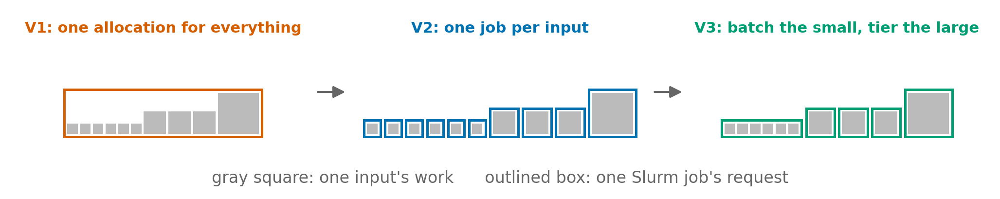
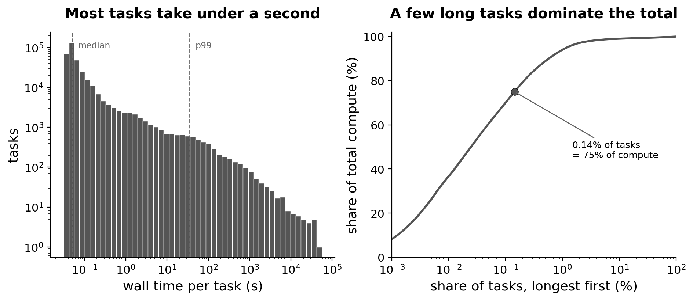
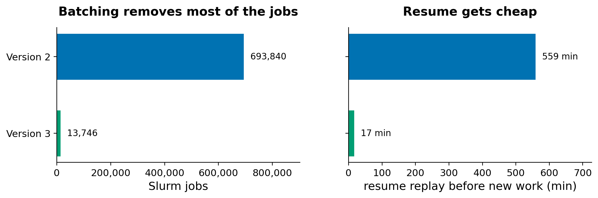

While working on a pipeline that had run smoothly on datasets of tens of thousands of inputs, I expected a much larger dataset to mostly mean a longer wait. Instead, one step that fans out into one independent task per input had to be redesigned twice before it ran cleanly at that scale, several hundred thousand inputs. The work inside each task stayed the same; what changed was how the step was split into jobs, sized and scheduled.

Here, I walk through the three versions of that step, what each one fixed, and the new limit each fix ran into, which only showed up at scale.



# The three versions at a glance

All numbers are for the fan-out step on the large dataset, about 347,000 inputs.

| | Version 1: one allocation | Version 2: one job per input | Version 3: batch the small |
|---|---|---|---|
| How the step runs | Every task runs inside one Slurm allocation | Each input is its own Slurm job, sized by its input-size tier | Small inputs batched 250 to a job, larger ones keep their size tiers |
| Slurm jobs | 1, holding every task | About 694,000 | About 13,700 |
| Memory | One shared allocation; the largest input alone needs about 18 GB | 1 GB for the smallest inputs, up to 96 GB for the largest | Same size tiers; the smallest tiers peak at 18 to 60 MB against 1 GB |
| Wall clock | More than 220 h | 132 h across restarts | At least the largest input's 30 h |
| Resuming after a stop | The whole allocation starts again | 9 h 19 min of replay before any new work | About 17 min |
| What broke | One failure restarts the whole run | Orchestrator heap, queue size, a missing time limit, slow resume | Staging many files per job slowed resume, until fixed |

# The shape of the work



Most inputs finish in well under a second, while a few hundred of the largest take minutes to hours and use most of the compute. Runtime follows input size, and input sizes are very uneven. This shape is not unique to this pipeline: per-sample alignment, per-gene model fits and per-region calls all fan out over inputs of very different sizes.

This shape drove most of the design decisions below. A single setting for every task does not work in either direction: sized for the largest inputs, it wastes most of its request on the rest, and sized for a typical input, it kills the largest ones.

Each task runs on a single thread. The tool splits its work across the columns of an input, not across its records, and every input here has roughly the same few hundred columns no matter how many records it holds. A larger input means more records, not more columns, so extra threads have little to share, and running several single-threaded tasks side by side makes better use of the same cores. Whether this holds depends on where a tool splits its work, so for a different tool it is worth checking that first.

# Version 1: one allocation for everything

The first version ran the whole step inside a single Slurm allocation. The orchestrator ran every task locally on that allocation's cores, and the allocation's size came from an estimator calibrated on the datasets I had processed so far. On those, one job meant no scheduling overhead and nothing to tune per task.

The problem is that it does not scale. Everything shares one box, so the box has to be big enough for the largest inputs and long enough for the sum of all of them. On the large dataset, the summed work at the concurrency this version reached would keep one allocation busy for well over a week, and a single failure anywhere would restart the whole allocation.

The estimator had a second problem. Even the largest input it had been calibrated on finished in minutes using tens of megabytes; in the new dataset, the largest ran for more than a day and needed gigabytes. An estimator fitted on smaller inputs can be trusted below the largest input it has seen, not above it: scaling down is safe, scaling up is a guess.

# Version 2: one job per input, tiered by size

The second version gave every input its own Slurm job and sized each job from the data. Inputs were grouped into tiers by their number of records, and the estimator gave each tier its own memory, time and array settings.

This is what let the step run at this scale at all. The largest inputs got the memory and time they needed, and the work spread across many machines instead of queuing inside one box.

The same estimator also sized the other steps in the pipeline, with a simple model calibrated on finished runs: a baseline, a term that grows with the input, and one headroom margin.

```
units   = max(1, ceil(n_records / 1,000,000))
runtime = (baseline + per_unit x (units - 1)) x 1.25
memory  = baseline, or floor + per_record x records_in_this_job
```

Time and memory did not follow the same rule. Runtime grew steeply with the input. Memory was either flat or depended on the records one job held, and some steps stream their input so their peak is set by the chunk they hold, not the file. Fitting both to one "per million records" curve would have overstated memory for every step that splits or streams its input.

A few more decisions were judgment calls rather than fits:

- **Whole units, with a floor of one.** Anything under a million records gets the baseline and is over-provisioned on purpose. For small data that waste is cheap, and the alternative is fitting noise.
- **Headroom applied exactly once.** It is easy to stack a margin in the constant, another in the config, and another at submission. I keep one, in one place.
- **A warning, not a cap.** A request above a threshold is a sign that the step should be split into smaller chunks. A cap would only move the failure to runtime.

## What broke at scale

One job per input seemed like a clean design, since every task got exactly the resources its size tier called for. In practice, it meant hundreds of thousands of Slurm jobs for a single dataset, and most of them spent longer being scheduled and started than actually computing. The step took days of wall clock across restarts.

The job count also exposed the orchestrator as a resource of its own. The fan-out runs as a Nextflow workflow inside one Snakemake rule, and the Nextflow head is a Java process that keeps track of every task in memory, up to a fixed limit called the heap.

- **Heap.** It filled up partway through the run, so it is now sized from the head's own memory request.
- **Queue size.** The head limits how many jobs it keeps submitted at once. The default was small enough that only one array ran at a time, so I raised it by an order of magnitude.
- **Time limits.** One task type had no time limit set and fell back to the scheduler's default, so every one of its jobs asked for days.
- **Resume.** After a stop, the head replays every cached task before it submits anything new. With hundreds of thousands of tasks, that replay alone took most of a day.

None of these showed up on the earlier datasets. All of them appeared only once every input became its own job, and the job count reached the hundreds of thousands. I covered the manual version of this orchestration, where one step waits on hundreds of array jobs from the step before, in the [Slurm arrays post](/2025-09-10-slurm-array/).

# Version 3: batch the small, tier the large

The third version keeps the size tiers and changes how the step is split into jobs:

- **Batching.** The smallest inputs are grouped, 250 to a job. They are nearly all of the inputs and almost none of the compute, so batching them removes most of the jobs without making any job long.
- **Tier settings from measured baselines.** With baseline numbers from the version 2 runs, the estimator now writes each tier's memory, time and array size into a Nextflow config overlay (`withName` blocks), so the numbers live in one place.
- **One thread per task**, for the reasons above, so more tasks fit on the same cores.



Fewer jobs fixed more than just scheduling. The orchestrator tracks fewer tasks, so its heap and queue limits stop being the bottleneck, and a resume replays a small number of batched tasks instead of every input. On one of the earlier, smaller datasets that version 1 had handled in one allocation, version 3 finished several times faster, because the work now spreads across many machines in under a thousand jobs.

The small tiers still peak far below their memory request, which is acceptable: those tiers are cheap, and a job that fails on memory costs more than one that wastes it.

# Where this setup would not work

Sizing by input size, batching and tiering all assume a few things about the work and the compute setup. Where those assumptions break, a different approach fits better.

| Situation | Why this setup struggles | What works better |
|---|---|---|
| Cost depends on the content, not the size | A search that converges slowly or a fit that needs more iterations is invisible to a size-based model | Retry failed jobs with a larger request |
| One-off datasets | Calibration only pays off across many runs | Generous flat requests, then a look at `sacct` |
| Mixed hardware | The constants describe the nodes they were measured on | Calibrate separately for each node type, or use a larger margin |
| Caps on job counts | One job per input can exceed array or queue limits outright | Batching from the start |
| Paying per<br>core&#8209;hour | Over-allocation costs money, not just queue time | Tighter requests with automatic retries |
| I/O-bound steps | Memory and time models miss filesystem contention from many small jobs | Fewer, larger jobs and fewer small files |
{: .even-cols}

# Takeaways

These are the lessons I took away from the three versions:

- **A design that works at one size can fail at the next.** Test the fan-out at the size you plan to run, not the size you have.
- **Heavy-tailed work is not one population.** Batching the small tasks and tiering the large ones by size handled both ends.
- **Count the jobs, not just the resources.** Scheduling, orchestrator memory and resume time all grew with the number of tasks.
- **Calibrate on the largest inputs you expect.** An estimator can be trusted below its calibration range, not above it. Keep the model simple, and apply headroom once.
- **Prefer a loud warning to a silent cap.** A request that outgrows the design is a sign to split the step, not to hide the problem.

None of these changes were complicated on their own. What made them hard to see was that each limit only appeared at a scale the previous version had never reached, and I expect the next, larger dataset to find another one.
